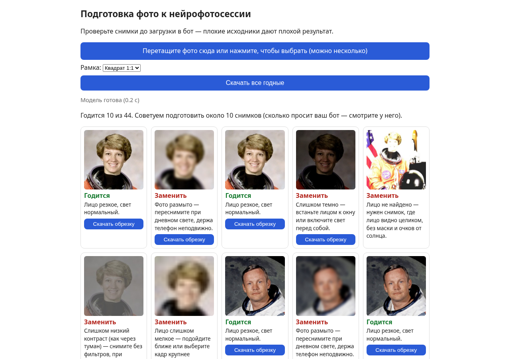

# Проверьте фото до загрузки в нейрофотосессию

**Фото не покидает ваше устройство:** всё проверяется прямо в браузере, без регистрации и без сервера.

*На скриншоте «Модель готова (0.2 с)» снято с локальной копии; на медленной сети модель грузится до ~25 с.*

Перед тем как платить боту за нейрофотосессию, загрузите сюда свои снимки. Страница:
- найдёт лицо и обрежет кадр (1:1 или 4:5);
- проверит резкость и свет;
- скажет «Годится» или «Заменить» и что именно переснять;
- подскажет, какие 10 фото подготовить.

**Ограничения:** пороги подобраны на 5 портретах NASA с искусственными дефектами, размытие проверено всего на 3 реальных смазанных фото; портрет в обычных очках или очень крупный план может получить «лицо не найдено»; нормальное фото на тёмном фоне может получить «темно»; маски и фильтры не определяются; iOS Safari не проверен. Нашли ошибку — [предложите улучшение](https://github.com/Phenolemox/photoprep/issues/new).

Темы репозитория: `ai-photoshoot`, `face-detection`, `privacy`, `browser-only`, `photo-checker`.

---
## Для разработчиков

Одна страница: выбрать фото → для каждого поиск лица, обрезка по рамке (1:1 или 4:5), резкость, свет, вердикт «Годится / Заменить» с советом, скачивание обрезки. Всё в браузере, фото не отправляются.

Запуск локально: `python3 -m http.server -d artifacts/photoprep/v1 8000` → http://localhost:8000/ (нужен http, не file://, из-за wasm/ES-модулей).
Тексты интерфейса — только в `strings.js` (источник: copy_LIRA.md).
Ссылка «Предложить улучшение» ведёт на https://github.com/Phenolemox/photoprep/issues/new — **репозиторий ещё не создан**, до публикации ссылка даёт 404.
Удаление фона в v0 не сделано (см. MESSAGE.txt).
